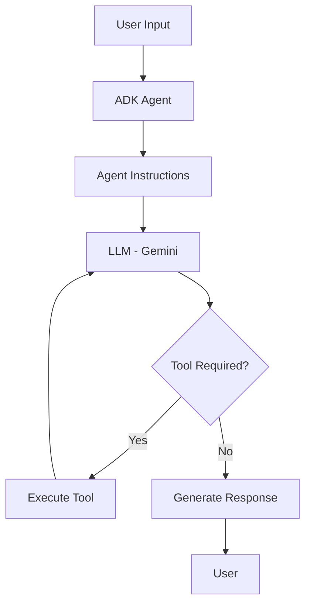

# Google ADK – AI Agent Development

\<p align="center">
&#x20; \*\*Building Intelligent AI Agents with Python and Google's Agent Development Kit\*\*
\</p>

\<p align="center">
&#x20; ![Python]\([https://img.shields.io/badge/Python-3.10%2B-blue?logo=python](https://img.shields.io/badge/Python-3.10%2B-blue?logo=python))
&#x20; ![Google ADK]\([https://img.shields.io/badge/Framework-Google%20ADK-4285F4?logo=google](https://img.shields.io/badge/Framework-Google%20ADK-4285F4?logo=google))
&#x20; ![Gemini]\([https://img.shields.io/badge/LLM-Gemini-8E75B2?logo=google](https://img.shields.io/badge/LLM-Gemini-8E75B2?logo=google))
&#x20; ![Status]\([https://img.shields.io/badge/Status-Active-success](https://img.shields.io/badge/Status-Active-success))
&#x20; ![License]\([https://img.shields.io/badge/License-MIT-green](https://img.shields.io/badge/License-MIT-green))
\</p>

---

## Overview

This repository is a collection of practical implementations and experiments using **Google Agent Development Kit (ADK)**, a framework for building, orchestrating, and deploying AI agents.

The primary objective is to explore the fundamentals of Agentic AI and understand how intelligent agents can interact with tools, process user requests, and perform tasks through structured workflows.

This repository focuses on hands-on development, practical experimentation, and learning how to build AI-powered applications using Python.

## Projects

This repository currently contains the following implementations:

### 1. Mayank Negi

**Directory:** `mayank_negi/`

An individual Google ADK project.

- Agent implementation and configuration.
- Exploration of Google ADK capabilities.
- Practical experimentation with LLM-powered agents.

### 2. Search File

**Directory:** `search_file/`

A separate project exploring file-search-related functionality using Google ADK.

- Exploring file-search workflows.
- Understanding agent interaction with information sources.
- Experimenting with AI-powered information retrieval.

*Detailed implementation descriptions and examples will be added as the projects evolve.*

## What is Google ADK?

Google Agent Development Kit is an open-source, code-first framework that helps developers build AI agents.

It provides capabilities for:

- Creating LLM-powered agents.
- Integrating external tools.
- Managing agent workflows.
- Building multi-agent systems.
- Managing sessions and state.
- Evaluating and deploying AI agents.

Official Documentation: [https://google.github.io/adk-docs/](https://google.github.io/adk-docs/)

GitHub: [https://github.com/google/adk-python](https://github.com/google/adk-python)

## Technology Stack

| Technology       | Purpose                     |
| ---------------- | --------------------------- |
| Python           | Core programming language   |
| Google ADK       | Agent development framework |
| Gemini           | Large Language Model        |
| Google AI Studio | API key and model access    |
| VS Code          | Development environment     |
| Git & GitHub     | Version control             |

## Architecture

The general execution flow of an LLM-powered agent can be represented as:



*This is a conceptual illustration of an agent workflow, not a verified diagram of every implementation in this repository.*

## Getting Started

Follow these instructions to set up the project locally.

### Prerequisites

- Python 3.10 or later, compatible with your installed Google ADK version.
- Git.
- Google AI Studio API key.

### 1. Clone the Repository

```bash
git clone https://github.com/mayanknegi22/Google-adk.git
```

### 2. Navigate to the Project

```bash
cd Google-adk
```

### 3. Create a Virtual Environment

```bash
python -m venv .venv
```

### 4. Activate the Environment

**Windows PowerShell:**

```powershell
.\.venv\Scripts\Activate.ps1
```

**Linux / macOS:**

```bash
source .venv/bin/activate
```

### 5. Install Google ADK

```bash
pip install google-adk
```

### 6. Configure API Credentials

Create a `.env` file in the appropriate agent directory.

Example:

```env
GOOGLE_GENAI_USE_VERTEXAI=FALSE
GOOGLE_API_KEY=your_google_api_key
```

Get your API key from:

[https://aistudio.google.com/apikey](https://aistudio.google.com/apikey)

**Security:** Never commit your `.env` file, API keys, or credentials to GitHub.

### 7. Run the Agent

Navigate to the directory containing the relevant ADK agent package and execute:

```bash
adk web
```

You can also run an agent through the ADK terminal interface:

```bash
adk run <agent_folder_name>
```

Replace `<agent_folder_name>` with the actual agent package name.

## Key Learning Areas

Through these implementations, this repository explores:

- Fundamentals of Agentic AI.
- Google ADK architecture.
- LLM-powered agent development.
- Agent instructions and configurations.
- Tool integration and execution.
- AI-powered search and information retrieval.
- Agent workflows and orchestration.
- Practical Python application development.

## Future Roadmap

- [ ] Develop more advanced AI agents.
- [ ] Explore custom tool integrations.
- [ ] Implement multi-agent architectures.
- [ ] Explore session management and memory.
- [ ] Build more advanced search and retrieval workflows.
- [ ] Implement agent evaluation.
- [ ] Explore deployment of AI agent applications.

## Learning Resources

- [Google ADK Documentation](https://google.github.io/adk-docs/)
- [Google ADK Python Repository](https://github.com/google/adk-python)
- [Google AI Studio](https://aistudio.google.com/)
- [Google AI Developer Documentation](https://ai.google.dev/)

## Author

**Mayank Negi**

MCA Graduate | Aspiring AI Engineer | Generative AI & Agentic AI Enthusiast

- GitHub: [@mayanknegi22](https://github.com/mayanknegi22)

---

\<p align="center">   \*\*Building. Learning. Experimenting with Agentic AI.\*\* \</p>

\<p align="center">   If you find this repository interesting, consider giving it a ⭐. \</p>
