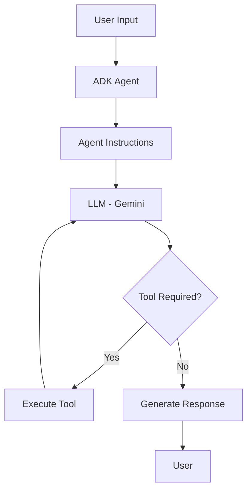

# Google ADK Projects

### Exploring Agentic AI with Google's Agent Development Kit

Building practical AI agent applications using Python, Google's Agent Development Kit (ADK), and Gemini.

<p align="left">
  
  
  
  
</p>

---

## About This Repository

Welcome to my **Google ADK Projects** repository!

This repository documents my hands-on journey into **Agentic AI development** using Google's Agent Development Kit.

My objective is to move beyond basic LLM interactions and understand how AI agents can be designed, configured, connected with tools, and organized into structured workflows.

Instead of focusing only on theory, I use this repository to experiment with concepts and build practical implementations as I learn.

### What I'm Exploring

- Building AI agents using Google ADK.
- Understanding agent instructions and execution flow.
- Integrating Large Language Models (LLMs).
- Connecting agents with tools and external functionality.
- Exploring search-based and information-retrieval workflows.
- Understanding multi-agent systems and orchestration.
- Developing practical Agentic AI applications.

---

## What is Google ADK?

**Google Agent Development Kit (ADK)** is an open-source framework for developing, orchestrating, evaluating, and deploying AI agents.

It provides a structured approach to building agents that can use LLMs, interact with tools, and execute tasks through defined workflows.

Official resources:

- [Google ADK Documentation](https://google.github.io/adk-docs/)
- [Google ADK Python Repository](https://github.com/google/adk-python)

---

## Repository Structure

```text
Google-adk/
│
├── mayank_negi/
│   └── Agent-related project files
│
├── search_file/
│   └── Search and file-related project files
│
├── .gitignore
│
└── README.md
```

### Project Folders

| Folder | Description |
|---|---|
| `mayank_negi/` | Project workspace for Google ADK-related implementation and experimentation. |
| `search_file/` | Project workspace for search and file-related implementation. |

The folders will be documented in more detail as their implementations evolve.

---

## How AI Agent Workflows Fit Together

The following is a conceptual overview of an LLM-powered agent workflow. It is intended to explain the learning concepts, not to represent a verified implementation of every component in this repository.



---

## Tech Stack

| Technology | Purpose |
|---|---|
| Python | Primary programming language |
| Google ADK | AI agent development framework |
| Gemini | Large Language Model |
| Google AI Studio | Gemini API access |
| VS Code | Development environment |
| Git & GitHub | Version control and project management |

---

## Getting Started

Follow these steps to set up the project locally.

### 1. Clone the Repository

```bash
git clone https://github.com/mayanknegi22/Google-adk.git
```

### 2. Navigate to the Project

```bash
cd Google-adk
```

### 3. Create a Virtual Environment

```bash
python -m venv .venv
```

### 4. Activate the Virtual Environment

**Windows PowerShell:**

```powershell
.\.venv\Scripts\Activate.ps1
```

**Linux / macOS:**

```bash
source .venv/bin/activate
```

### 5. Install Google ADK

```bash
pip install google-adk
```

For reproducible project setup, install any additional dependencies specified by the individual project.

### 6. Configure Your Gemini API Key

Create a `.env` file in the appropriate project directory and add:

```env
GOOGLE_GENAI_USE_VERTEXAI=FALSE
GOOGLE_API_KEY=your_google_api_key
```

Get your API key from:

[Google AI Studio – API Keys](https://aistudio.google.com/apikey)

**Important:** Never commit your actual API key, `.env` file, or other credentials to GitHub.

### 7. Run an ADK Agent

Once you have configured an agent, open the terminal in the appropriate parent directory and run:

```bash
adk web
```

Refer to the [Google ADK documentation](https://google.github.io/adk-docs/) for the correct execution directory and configuration for your agent.

---

## Learning Roadmap

My ongoing learning objectives include:

- [x] Set up a Python development environment.
- [x] Explore Google's Agent Development Kit.
- [ ] Understand agent instructions and configurations.
- [ ] Build practical LLM-powered agents.
- [ ] Explore tool integration and function execution.
- [ ] Experiment with search and retrieval workflows.
- [ ] Understand sessions and memory management.
- [ ] Explore multi-agent systems.
- [ ] Learn agent evaluation and deployment.

---

## Learning Resources

| Resource | Link |
|---|---|
| Google ADK Documentation | [Official Docs](https://google.github.io/adk-docs/) |
| Google ADK Python | [GitHub](https://github.com/google/adk-python) |
| Google AI Studio | [Visit](https://aistudio.google.com/) |
| Google AI for Developers | [Visit](https://ai.google.dev/) |

---

## About Me

**Mayank Negi**

MCA Graduate | Aspiring AI Engineer | Generative AI & Agentic AI Enthusiast

I'm interested in building practical AI applications and continuously improving my understanding of Python, LLMs, RAG systems, and Agentic AI.

- **GitHub:** [mayanknegi22](https://github.com/mayanknegi22)
- **Repository:** [Google ADK Projects](https://github.com/mayanknegi22/Google-adk)

---

If you find this repository interesting, feel free to explore the code and follow my learning journey.

**More experiments and implementations coming soon!**
