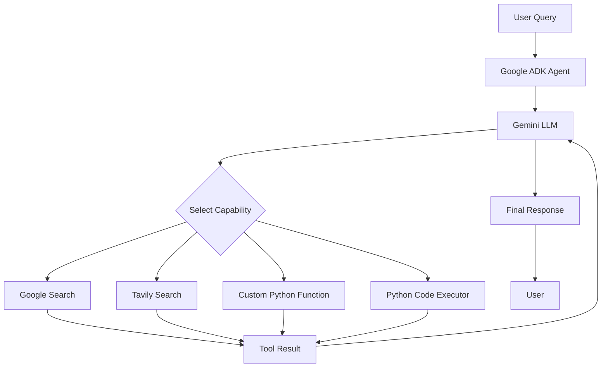

# Google ADK – Hands-on AI Agent Projects

### Exploring LLMs, Tool Integration, Web Search and Agentic AI with Python

<p align="left">
  
  
  
  
</p>

---

## About This Repository

This repository contains my hands-on implementations and experiments with **Google's Agent Development Kit (ADK)**.

The goal is to understand how AI agents work beyond simple LLM conversations by building agents with different capabilities, integrating external tools, and exploring how multiple tools can work together.

The repository currently contains six agent implementations, ranging from a basic Gemini-powered conversational agent to a combined agent capable of web search, Python code execution, and timezone-based date and time retrieval.

Each project focuses on a particular ADK concept and helps build a practical understanding of Agentic AI development.

---

## Projects

### 1. Basic Gemini Agent — `mayank_negi/`

A simple conversational AI agent built using Google's ADK and Gemini.

**What it does:**
- Accepts user questions and instructions.
- Uses Gemini to generate responses.
- Follows the instructions defined in its agent configuration.

**Concepts explored:**
- Creating an ADK agent.
- Configuring an LLM.
- Defining agent names, descriptions, and instructions.
- Understanding the basic agent execution flow.

**Model:** `gemini-3.5-flash`

---

### 2. Google Search Agent — `search_file/`

An AI agent integrated with Google's built-in Search tool.

Instead of relying only on the model's existing knowledge, this agent can use Google Search when current information or fact verification is needed.

**What it does:**
- Accepts user queries.
- Uses Google Search to retrieve relevant information.
- Uses search results to help generate responses.
- Supports questions requiring current information.

**Concepts explored:**
- ADK built-in tools.
- Google Search integration.
- Tool selection by an LLM.
- Grounding responses with search results.

**Model:** `gemini-3.5-flash`

> Note: Despite the folder name `search_file`, the current implementation uses Google Search. It does not implement local file searching.

---

### 3. Tavily Search Agent — `tavily_search_agent/`

An AI agent that integrates Tavily Search through LangChain and Google's ADK.

The Tavily tool is wrapped using ADK's `LangchainTool`, allowing the agent to use a third-party LangChain tool.

**What it does:**
- Accepts web-search-related questions.
- Invokes Tavily Search when information needs to be retrieved or verified.
- Retrieves up to five general search results.
- Uses the search results to help formulate an answer.

**Technologies used:**
- Google ADK
- Gemini
- LangChain
- LangChain Tavily integration

**Concepts explored:**
- Third-party tool integration.
- LangChain and ADK interoperability.
- Wrapping external tools using `LangchainTool`.
- Connecting web-search capabilities to an AI agent.

**Model:** `gemini-3.5-flash`

---

### 4. World Clock Agent — `world_clock_agent/`

A specialized AI agent that retrieves the current date and time for different locations around the world.

It uses a custom Python function and the `datetime` and `zoneinfo` modules.

**What it does:**
- Accepts a timezone such as `Asia/Kolkata` or `America/New_York`.
- Retrieves the current local date and time.
- Returns the timezone, date, time, and weekday.
- Handles invalid timezone names with an error response.

**Technologies used:**
- Python `datetime`
- Python `zoneinfo`
- Google ADK
- Gemini

**Concepts explored:**
- Creating custom Python function tools.
- Passing arguments to tools.
- Returning structured tool results.
- Handling exceptions.
- Connecting deterministic Python functionality with an LLM agent.

---

### 5. Code Execution Agent — `code_execution_agent/`

An AI agent configured with Google's built-in `BuiltInCodeExecutor`.

This agent is designed to write and execute Python code when a question involves calculations, data analysis, or other tasks that benefit from programmatic execution.

**What it does:**
- Understands the user's question.
- Writes Python code when execution is useful.
- Executes the generated code using ADK's code executor.
- Explains the result to the user.

**Technologies used:**
- Google ADK
- Gemini
- Python
- `BuiltInCodeExecutor`

**Concepts explored:**
- Code execution in AI agents.
- Built-in ADK executors.
- Combining LLM reasoning with Python execution.
- Using code for calculations and data analysis.

**Security consideration:** Code generated by an LLM should only be executed in an appropriately controlled environment. Never assume generated code is safe to run against sensitive systems or data.

---

### 6. Combined Multi-Tool Agent — `combined_tool_agent/`

This is the most feature-rich implementation in the repository.

It combines multiple tools inside a single Gemini-powered ADK agent, allowing the agent to select the appropriate capability based on the user's request.

**Tools integrated:**

| Tool | Purpose |
|---|---|
| Google Search | Retrieves current information and performs quick fact checks. |
| Tavily Search | Provides additional web-search results and more detailed research. |
| Custom Time Function | Retrieves the current date and time for a requested timezone. |
| BuiltInCodeExecutor | Executes Python code for calculations and data analysis. |

**What it can do:**
- Search the web using Google Search.
- Perform additional web searches using Tavily.
- Retrieve the current time in different timezones.
- Execute Python code for calculations and data analysis.
- Select tools according to the task.
- Provide answers using the results returned by the tools.

**Technologies used:**
- Google ADK
- Gemini
- Google Search
- LangChain
- LangChain Tavily
- Python `datetime` and `zoneinfo`
- `BuiltInCodeExecutor`

**Concepts explored:**
- Multiple tools in one agent.
- Custom function tools.
- Third-party tool integration.
- Built-in tool integration.
- Tool selection and orchestration.
- Combining LLM reasoning with deterministic Python functions.

---

## Repository Structure

```text
Google-adk/
│
├── code_execution_agent/
│   └── agent.py
│
├── combined_tool_agent/
│   └── agent.py
│
├── mayank_negi/
│   └── agent.py
│
├── search_file/
│   └── agent.py
│
├── tavily_search_agent/
│   └── agent.py
│
├── world_clock_agent/
│   └── agent.py
│
├── .gitignore
└── README.md
```

Each folder contains an independent ADK agent configuration.

---

## Architecture Overview

The repository explores different ways of extending an LLM-powered agent with tools.



This is a conceptual representation of the tool-enabled agent workflow. Individual agents in this repository use different subsets of these capabilities.

---

## Technology Stack

| Technology | Usage |
|---|---|
| Python | Primary programming language |
| Google ADK | Building and orchestrating AI agents |
| Gemini | LLM powering the agents |
| Google Search | Web search and information retrieval |
| Tavily | Third-party web-search integration |
| LangChain | Tool integration through LangchainTool |
| BuiltInCodeExecutor | Python code execution |
| datetime | Date and time handling |
| zoneinfo | Timezone conversion and validation |
| Git & GitHub | Version control |

---

## Getting Started

### Prerequisites

- Python version supported by your installed Google ADK release.
- Git.
- Google AI Studio API key.
- Tavily API key for projects using Tavily Search.

### 1. Clone the Repository

```bash
git clone https://github.com/mayanknegi22/Google-adk.git
```

### 2. Navigate to the Project

```bash
cd Google-adk
```

### 3. Create a Virtual Environment

```bash
python -m venv .venv
```

### 4. Activate the Virtual Environment

**Windows PowerShell**

```powershell
.\.venv\Scripts\Activate.ps1
```

**Linux / macOS**

```bash
source .venv/bin/activate
```

### 5. Install Dependencies

```bash
pip install google-adk langchain-tavily
```

### 6. Configure API Keys

Set the following environment variables in your environment or in the `.env` file used by your ADK project:

```env
GOOGLE_GENAI_USE_VERTEXAI=FALSE
GOOGLE_API_KEY=your_google_api_key
TAVILY_API_KEY=your_tavily_api_key
```

Get your Gemini API key:

https://aistudio.google.com/apikey

Get your Tavily API key:

https://tavily.com/

The Tavily key is needed for `tavily_search_agent` and `combined_tool_agent`. The other agents do not use Tavily.

**Important:** Never commit API keys or `.env` files to GitHub.

### 7. Run an Individual Agent

From the repository root, use:

```bash
adk web
```

The ADK web interface can be used to select and interact with the available agent folders.

Alternatively, run a specific agent from the repository root:

```bash
adk run mayank_negi
```

Other agents:

```bash
adk run search_file
adk run tavily_search_agent
adk run world_clock_agent
adk run code_execution_agent
adk run combined_tool_agent
```

---

## Key Learning Outcomes

Through these implementations, I am exploring:

- Creating LLM-powered agents using Google ADK.
- Configuring Gemini models and agent instructions.
- Integrating built-in ADK tools.
- Creating custom Python function tools.
- Connecting third-party tools using LangChain.
- Retrieving information through web search.
- Executing Python code through an agent.
- Handling timezone-aware date and time operations.
- Combining multiple tools within a single agent.
- Understanding tool selection and agent orchestration.

---

## Future Improvements

- [ ] Add local file-search functionality to the `search_file` project.
- [ ] Add more custom Python tools.
- [ ] Explore multi-agent systems and agent delegation.
- [ ] Experiment with session management and memory.
- [ ] Add structured logging and error handling.
- [ ] Explore agent evaluation and testing.
- [ ] Build more advanced Agentic AI applications.
- [ ] Explore deployment options for ADK agents.

---

## Useful Resources

- [Google ADK Documentation](https://google.github.io/adk-docs/)
- [Google ADK Python GitHub](https://github.com/google/adk-python)
- [Google AI Studio](https://aistudio.google.com/)
- [LangChain Documentation](https://python.langchain.com/docs/)
- [Tavily Documentation](https://docs.tavily.com/)

---

## About Me

**Mayank Negi**

MCA Graduate | Aspiring AI Engineer | Generative AI & Agentic AI Enthusiast

I am interested in building practical AI applications and continuously improving my understanding of Python, Large Language Models, RAG systems, and Agentic AI.

- GitHub: [mayanknegi22](https://github.com/mayanknegi22)
- Repository: [Google ADK Projects](https://github.com/mayanknegi22/Google-adk)

---

<p align="center">
  <strong>Building. Learning. Experimenting with Agentic AI.</strong>
</p>
