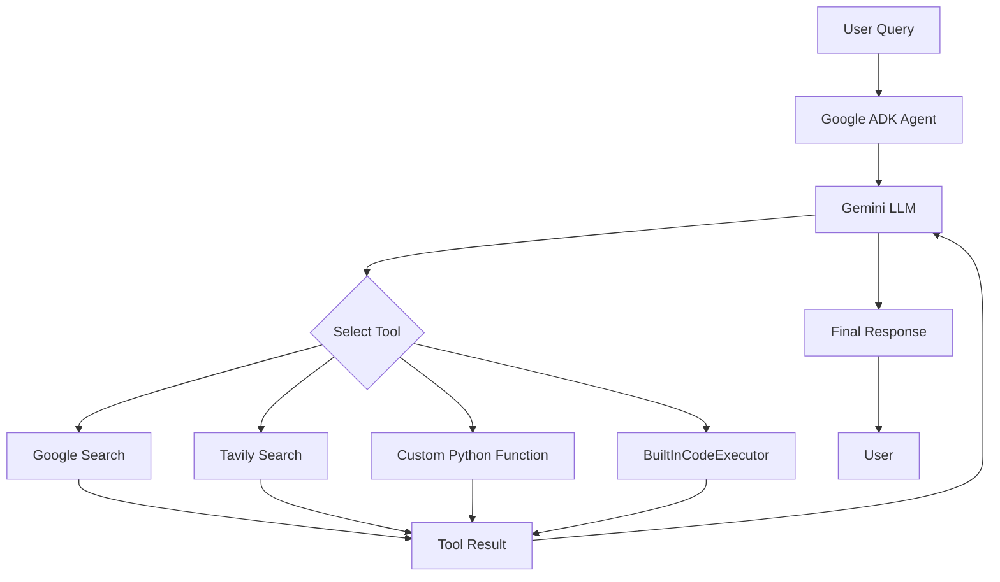
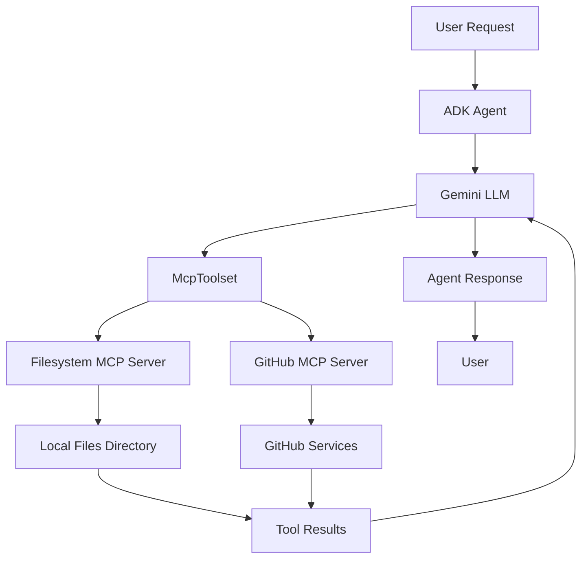
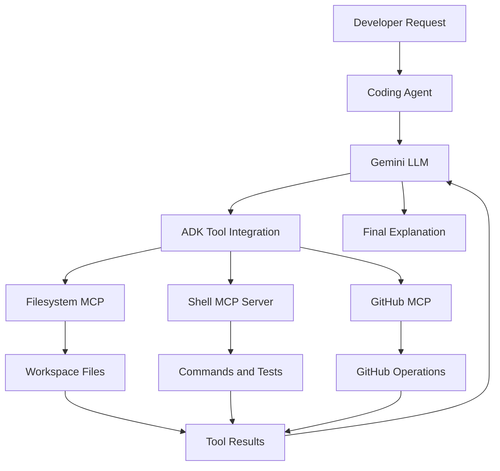

# 🤖 Google ADK — AI Agents, MCP & Agentic AI Projects

<p align="center">
  
  
  
  
  
</p>

<p align="center">
  <b>A hands-on collection of AI agent implementations using Google's Agent Development Kit (ADK).</b>
  <br />
  Exploring LLM-powered agents, tool calling, MCP integrations, structured outputs, code execution, and intelligent automation.
</p>

<p align="center">
  <a href="https://github.com/mayanknegi22">GitHub Profile</a> •
  <a href="https://google.github.io/adk-docs/">Google ADK Documentation</a> •
  <a href="https://modelcontextprotocol.io/">MCP Documentation</a>
</p>

---

## 📌 About This Repository

This repository contains my hands-on implementations and experiments with **Google's Agent Development Kit (ADK)**.

My objective is to understand how modern AI agents work beyond basic LLM conversations by building practical applications that can:

- Understand user instructions and generate intelligent responses.
- Search the web and retrieve external information.
- Call custom Python functions and external tools.
- Execute Python code for calculations and other tasks.
- Work with multiple tools within a single agent.
- Connect local and remote services through the Model Context Protocol (MCP).
- Read and modify files within a controlled workspace.
- Extract information into structured, validated formats.
- Assist with coding workflows, testing, and GitHub operations.

The repository demonstrates a progression from simple conversational agents to tool-enabled agents and MCP-powered coding workflows.

**Current collection: 9 independent agent implementations.**

---

## 🗂️ Projects Overview

| # | Project | Main Capability | Key Concept |
|---|---|---|---|
| 01 | Basic Gemini Agent | Conversational AI | LLM fundamentals |
| 02 | Google Search Agent | Web search | Built-in tools |
| 03 | Tavily Search Agent | Web research | LangChain integration |
| 04 | World Clock Agent | Timezone information | Custom Python tools |
| 05 | Code Execution Agent | Python execution | Built-in code executor |
| 06 | Combined Multi-Tool Agent | Multiple capabilities | Tool orchestration |
| 07 | GitHub Publisher MCP Agent | Filesystem and GitHub access | MCP integration |
| 08 | Coding Agent | Coding and development workflows | MCP, shell and approvals |
| 09 | Structured Output Agent | Information extraction | Pydantic schemas |

---

# 🚀 Individual Projects

## 1. Basic Gemini Agent

**Directory:** `mayank_negi/`

A basic conversational AI agent built using Google's Agent Development Kit and Gemini.

### Features
- Accepts user questions and instructions.
- Generates responses using Gemini.
- Follows agent-specific instructions.
- Demonstrates the fundamental structure of an ADK agent.

### Concepts Explored
- Agent initialization.
- Gemini model configuration.
- Agent names and descriptions.
- Instruction-based agent behavior.
- Basic LLM interaction.

---

## 2. Google Search Agent

**Directory:** `search_file/`

An AI agent integrated with Google's built-in Search tool.

Instead of relying exclusively on the model's existing knowledge, the agent can use Google Search to retrieve information relevant to a user's question.

### Features
- Accepts user queries.
- Uses Google Search for information retrieval.
- Supports questions requiring current information.
- Uses retrieved information to formulate responses.

### Concepts Explored
- Built-in ADK tools.
- Google Search integration.
- LLM tool selection.
- Search-grounded responses.

> Note: Despite the directory name `search_file`, the current implementation uses Google Search rather than local filesystem searching.

---

## 3. Tavily Search Agent

**Directory:** `tavily_search_agent/`

An AI agent that integrates Tavily Search through LangChain and Google ADK.

The implementation uses ADK's `LangchainTool` wrapper to make a third-party LangChain tool available to the agent.

### Features
- Performs web searches using Tavily.
- Retrieves up to five general search results.
- Uses search results to help answer user questions.

### Technologies
- Google ADK
- Gemini
- LangChain
- LangChain Tavily
- Tavily Search

### Concepts Explored
- Third-party tool integration.
- LangChain and ADK interoperability.
- `LangchainTool`.
- External search capabilities.

---

## 4. World Clock Agent

**Directory:** `world_clock_agent/`

A specialized AI agent that retrieves the current date and time for different locations around the world.

It uses custom Python functionality with the `datetime` and `zoneinfo` modules.

### Features
- Accepts timezone-related questions.
- Uses IANA timezone identifiers.
- Retrieves local date and time.
- Returns timezone, date, time, and weekday.
- Handles invalid timezone names.

### Example Timezones

```text
Asia/Kolkata
America/New_York
Europe/London
Asia/Tokyo
```

### Concepts Explored
- Custom Python function tools.
- Function arguments and return values.
- Timezone-aware date and time handling.
- Exception handling.
- Combining deterministic Python functionality with an LLM.

---

## 5. Code Execution Agent

**Directory:** `code_execution_agent/`

An AI agent configured with Google's built-in `BuiltInCodeExecutor`.

The agent can generate and execute Python code when a request involves calculations, data analysis, or other tasks that benefit from programmatic execution.

### Features
- Understands the user's request.
- Generates Python code when execution is useful.
- Executes code through ADK's built-in code executor.
- Explains the execution result.

### Technologies
- Google ADK
- Gemini
- Python
- `BuiltInCodeExecutor`

### Concepts Explored
- LLM-generated Python code.
- Built-in ADK executors.
- Programmatic calculations.
- Combining LLM reasoning with code execution.

**Security consideration:** Generated code should only execute in a controlled environment. Avoid exposing sensitive files, credentials, or systems to untrusted generated code.

---

## 6. Combined Multi-Tool Agent

**Directory:** `combined_tool_agent/`

This implementation combines multiple tools within a single Gemini-powered ADK agent.

The agent uses its instructions and the user's request to select an appropriate capability.

### Integrated Tools

| Tool | Purpose |
|---|---|
| Google Search | Web information retrieval |
| Tavily Search | Additional web research |
| Custom Time Function | Timezone-based date and time |
| BuiltInCodeExecutor | Python code execution |

### Features
- Searches the web using Google Search.
- Performs additional searches using Tavily.
- Retrieves current time across different timezones.
- Executes Python code for calculations and data analysis.
- Uses agent instructions to guide tool selection.
- Combines multiple capabilities in one agent.

### Concepts Explored
- Multiple tool integration.
- Custom function tools.
- Built-in ADK tools.
- Third-party tool integration.
- Tool selection and orchestration.
- Combining LLM reasoning with deterministic Python functions.

---

## 7. GitHub Publisher — MCP Agent

**Directory:** `mcp_agent/`

This project explores the **Model Context Protocol (MCP)** and how external MCP servers can be connected to a Google ADK agent.

The agent integrates two MCP servers:

1. Filesystem MCP Server
2. GitHub MCP Server

It uses Google's `McpToolset` to connect these servers and expose their available tools to the agent.

### A. Filesystem MCP Server

Uses:

```text
@modelcontextprotocol/server-filesystem
```

The local filesystem server runs through Node.js and `npx`, using a standard input/output (stdio) connection.

Features:
- Access to files within the configured directory.
- Filesystem operations through MCP tools.
- A dedicated working directory for file operations.

The agent creates a `files` directory inside its project folder and configures the filesystem server to use that directory.

### B. GitHub MCP Server

Connects to the GitHub Copilot MCP endpoint:

```text
https://api.githubcopilot.com/mcp/
```

Authentication is handled through a GitHub token stored in the environment variable:

```env
GITHUB_TOKEN=your_github_token
```

The agent can access the tools exposed by the connected GitHub MCP server, subject to the token's permissions and server capabilities.

### MCP Integration

The implementation uses:

- `McpToolset`
- `StdioConnectionParams`
- `StreamableHTTPConnectionParams`
- `StdioServerParameters`

| MCP Server | Transport | Purpose |
|---|---|---|
| Filesystem | Local stdio | Local file operations |
| GitHub | Remote Streamable HTTP | GitHub-related operations |

**Agent name:** `github_publisher`

### Concepts Explored
- Model Context Protocol.
- MCP client-server architecture.
- Local and remote MCP servers.
- Standard input/output transport.
- Streamable HTTP transport.
- MCP tool discovery and integration.
- Environment-based authentication.
- Connecting external services to Google ADK.

---

## 8. Coding Agent

**Directory:** `coding_agent/`

An AI coding assistant built using Google ADK and MCP integrations.

This agent explores how an AI agent can work with a local development workspace, execute commands, run tests, and interact with GitHub through external tools.

### Integrated Capabilities

| Integration | Purpose |
|---|---|
| Filesystem MCP | Read, create, edit and manage workspace files |
| Local Shell MCP Server | Run commands and manage development processes |
| GitHub MCP | Access GitHub operations when a token is configured |

### Features
- Inspects existing workspace files before making changes.
- Creates and edits project files.
- Executes development commands through a custom shell MCP server.
- Runs tests using pytest.
- Starts and monitors development servers through dedicated tools.
- Checks application URLs and retrieves server logs.
- Connects to GitHub when a personal access token is configured.
- Uses confirmation checks for potentially sensitive operations.

### Safety and Approval Workflow

The implementation distinguishes between operations that can run automatically and operations requiring approval.

Examples of automatically approved command prefixes include:

```text
pytest
python -m pytest
git status
git diff
git log
```

Other commands require confirmation. Starting a server also requires confirmation.

GitHub write operations are configured to require approval, while selected read operations do not.

### GitHub Integration

The agent uses the GitHub MCP endpoint:

```text
https://api.githubcopilot.com/mcp/
```

The GitHub connection is optional and is enabled when `GITHUB_PAT` is configured.

### Concepts Explored
- Building coding agents.
- Filesystem MCP integration.
- Custom shell MCP server.
- Tool filtering.
- Human approval workflows.
- Running tests through an agent.
- Development server management.
- GitHub MCP integration.
- Safer execution of development commands.

> Security note: Approval checks are useful safeguards, not a complete security boundary. Review commands, token permissions, workspace access and server exposure before using the agent with sensitive projects.

---

## 9. Structured Output Agent

**Directory:** `structured_output/`

An AI agent that extracts student enquiry information from natural-language messages and returns it in a predefined structured format.

This implementation uses **Pydantic models** with Google ADK's `output_schema`.

### Structured Data Model

The project defines an `Enquiry` model with fields such as:

| Field | Type | Purpose |
|---|---|---|
| `name` | Optional string | Student's full name |
| `email` | Optional string | Email address |
| `interested_in` | List of Literal values | Course interests |
| `budget_inr` | Optional integer | Budget in Indian rupees |

The supported course-interest values are:

```python
[
    "GenAI",
    "Data Science",
    "MLOps",
    "Deep Learning",
    "Other"
]
```

### Features
- Extracts information from natural-language messages.
- Uses a Pydantic model to define the output structure.
- Restricts course interests to predefined values.
- Validates budget values.
- Leaves unmentioned optional information empty instead of guessing.
- Stores the structured result using the ADK output key `enquiry`.

### Concepts Explored
- Structured LLM outputs.
- Pydantic `BaseModel`.
- Pydantic `Field`.
- Python type hints.
- `Literal` types.
- Schema-based output validation.
- ADK `output_schema`.
- ADK `output_key`.

### Example Input

```text
Hi, my name is Rahul Sharma.
My email is rahul@example.com.
I am interested in GenAI and MLOps.
My budget is 15k.
```

### Expected Structured Output

```json
{
  "name": "Rahul Sharma",
  "email": "rahul@example.com",
  "interested_in": [
    "GenAI",
    "MLOps"
  ],
  "budget_inr": 15000
}
```

The example demonstrates the intended schema and extraction behavior.

---

# 🏗️ Architecture Overview

## 1. Tool-Enabled Agent Workflow

The following diagram illustrates the general workflow used by the tool-enabled agents.



## 2. MCP Agent Architecture



## 3. Coding Agent Architecture



These diagrams are conceptual representations of the implemented integrations. Individual projects use different subsets of these capabilities.

---

# 🧰 Technology Stack

| Technology | Purpose |
|---|---|
| Python | Primary programming language |
| Google ADK | AI agent development and orchestration |
| Gemini | Large Language Model |
| Google Search | Web information retrieval |
| Tavily | Third-party web search |
| LangChain | Third-party tool integration |
| BuiltInCodeExecutor | Python code execution |
| Pydantic | Structured data models and validation |
| MCP | Standardized tool integration |
| McpToolset | Connects MCP servers to ADK agents |
| Node.js / npx | Runs the filesystem MCP server |
| Filesystem MCP | Local file operations |
| GitHub MCP | GitHub-related integrations |
| python-dotenv | Environment variable management |
| Git & GitHub | Version control |

---

# ⚙️ Getting Started

## Prerequisites

Install the following before running the projects:

- Python version supported by your installed Google ADK release.
- Git.
- Node.js and npm (required for local filesystem MCP integration).
- Google AI Studio API key.
- Tavily API key for Tavily-based agents.
- GitHub token for GitHub MCP integrations.

Verify the installations:

```bash
python --version
git --version
node --version
npm --version
npx --version
```

## 1. Clone the Repository

```bash
git clone https://github.com/mayanknegi22/Google-adk.git
```

## 2. Navigate to the Project

```bash
cd Google-adk
```

## 3. Create a Virtual Environment

```bash
python -m venv .venv
```

## 4. Activate the Environment

**Windows PowerShell**

```powershell
.\.venv\Scripts\Activate.ps1
```

If PowerShell blocks script execution, use:

```powershell
Set-ExecutionPolicy -Scope Process -ExecutionPolicy Bypass
.\.venv\Scripts\Activate.ps1
```

**Linux / macOS**

```bash
source .venv/bin/activate
```

## 5. Install Dependencies

Install Google ADK with MCP support:

```bash
pip install "google-adk[mcp]"
```

Install additional integrations:

```bash
pip install -U langchain-tavily python-dotenv
```

Some projects may require additional dependencies depending on their implementation.

## 6. Configure Environment Variables

Create the necessary `.env` files for the agents you intend to run.

Example configuration:

```env
GOOGLE_GENAI_USE_VERTEXAI=FALSE

GOOGLE_API_KEY=your_google_api_key

TAVILY_API_KEY=your_tavily_api_key

GITHUB_TOKEN=your_github_token
```

For the coding agent, configure its own `.env` file inside `coding_agent/`:

```env
WORKSPACE_DIR=workspace
GITHUB_PAT=your_github_personal_access_token
```

`GITHUB_PAT` is optional for the coding agent. Without it, the agent can still use its local filesystem and shell integrations.

The `mcp_agent` uses `GITHUB_TOKEN`, while `coding_agent` uses `GITHUB_PAT`.

### API Key Resources

| Service | Link |
|---|---|
| Google AI Studio | https://aistudio.google.com/apikey |
| Tavily | https://tavily.com/ |
| GitHub Personal Access Tokens | https://github.com/settings/tokens |

### Important Security Notes

- Never upload `.env` files to GitHub.
- Never hardcode API keys or tokens inside Python files.
- Use only the minimum permissions required for your tokens.
- Keep filesystem MCP access restricted to the intended workspace.
- Review GitHub write operations and shell commands before approving them.
- Keep credentials private.

---

# ▶️ Running the Agents

Run commands from the repository root after activating your virtual environment.

## Option 1: Start ADK Web

```bash
adk web
```

Open the local ADK web interface shown in your terminal and select the agent you want to test.

## Option 2: Run an Individual Agent

```bash
adk run mayank_negi
```

Other available agents:

```bash
adk run search_file
adk run tavily_search_agent
adk run world_clock_agent
adk run code_execution_agent
adk run combined_tool_agent
adk run mcp_agent
adk run coding_agent
adk run structured_output
```

Make sure the required environment variables and dependencies are configured for the selected agent.

**Important:** The coding agent has its own `.env` configuration. Its GitHub integration is optional, but its local filesystem and shell integrations require the relevant MCP dependencies and server files to be available.

---

# 📚 Key Learning Outcomes

Through these implementations, I am exploring and practising:

- Fundamentals of Agentic AI.
- Google ADK architecture.
- Gemini model integration.
- Agent instructions and configurations.
- Built-in ADK tools.
- Custom Python function tools.
- Third-party tool integration.
- Web search and information retrieval.
- Python code execution.
- Multiple tool orchestration.
- Model Context Protocol.
- Local and remote MCP servers.
- MCP transports: stdio and Streamable HTTP.
- Filesystem and GitHub integrations.
- Human approval workflows.
- Structured outputs using Pydantic.
- Schema-based data extraction.
- Environment-based authentication.

---

# 🔭 Future Improvements

This repository is an ongoing learning project. Areas I plan to explore further include:

- Implementing more advanced multi-agent systems.
- Exploring agent delegation and coordination.
- Adding session management and persistent memory.
- Implementing MCP tool filtering and access controls.
- Improving structured logging and error handling.
- Adding automated agent evaluation and testing.
- Exploring RAG-based agent applications.
- Experimenting with additional MCP servers.
- Exploring deployment options for ADK agents.
- Building more practical Agentic AI applications.

---

# 📖 Learning Resources

| Resource | Link |
|---|---|
| Google ADK Documentation | https://google.github.io/adk-docs/ |
| Google ADK Python | https://github.com/google/adk-python |
| Model Context Protocol | https://modelcontextprotocol.io/ |
| MCP Servers | https://github.com/modelcontextprotocol/servers |
| Google AI Studio | https://aistudio.google.com/ |
| LangChain Documentation | https://python.langchain.com/docs/ |
| Tavily Documentation | https://docs.tavily.com/ |
| Pydantic Documentation | https://docs.pydantic.dev/ |

---

# 🔐 Security

This repository includes agents capable of interacting with external services, local files, and development commands.

Please follow these precautions:

1. Keep API keys and personal access tokens out of source control.
2. Use restricted filesystem workspaces.
3. Apply least-privilege permissions to GitHub tokens.
4. Review potentially destructive shell and GitHub operations.
5. Avoid executing untrusted generated code in environments containing sensitive data.

---

# 👨‍💻 About Me

**Mayank Negi**

MCA Graduate | Aspiring AI Engineer | Generative AI & Agentic AI Enthusiast

I am interested in building practical AI applications and continuously improving my understanding of Python, Large Language Models, RAG systems, and Agentic AI.

I enjoy learning by building projects, experimenting with tools, understanding agent architectures, and exploring how AI can solve real-world problems.

- **GitHub:** https://github.com/mayanknegi22
- **Repository:** https://github.com/mayanknegi22/Google-adk

---

<p align="center">
  <b>Building • Learning • Experimenting</b>
  <br />
  Exploring the possibilities of Agentic AI with Google ADK.
</p>
