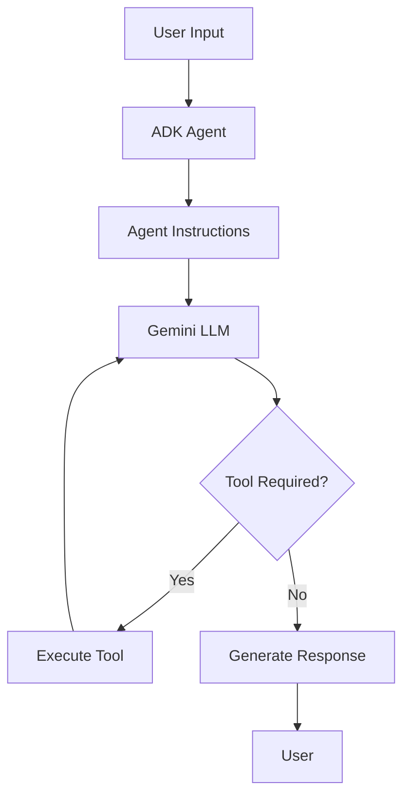

# Google ADK – AI Agent Development

\<p align="center">
&#x20; \<strong>Building Intelligent AI Agents with Python and Google's Agent Development Kit\</strong>
\</p>

\<p align="center">
&#x20; \
&#x20; \
&#x20; \
&#x20; \
\</p>

---

## Overview

Welcome to my **Google ADK – AI Agent Development** repository.

This repository is dedicated to exploring and building AI agents using Google's Agent Development Kit (ADK), an open-source framework designed to simplify the development, orchestration, and deployment of intelligent agents.

The main objective of this project is to gain practical experience in Agentic AI by building applications that leverage Large Language Models (LLMs), tools, and structured agent workflows.

Rather than focusing only on theoretical concepts, this repository emphasizes hands-on implementation, experimentation, and understanding how AI agents work internally.

## Projects

This repository contains multiple practical implementations using Google ADK.

### 1. Mayank Negi

**Directory:** `mayank_negi/`

An individual AI agent implementation exploring Google ADK capabilities and LLM-powered agent development.

### 2. Search File

**Directory:** `search_file/`

An implementation focused on exploring file-search functionality and AI-powered information retrieval using Google ADK.

*More implementation details, features, and examples will be documented as the projects evolve.*

---

## What is Google ADK?

Google Agent Development Kit (ADK) is an open-source, code-first framework for building AI agents.

It provides developers with the ability to:

- Build LLM-powered AI agents.
- Integrate external tools and APIs.
- Define agent instructions and behavior.
- Create multi-agent systems.
- Manage sessions and conversational state.
- Build structured agent workflows.
- Evaluate and deploy AI agents.

**Official Resources:**

- [Google ADK Documentation](https://google.github.io/adk-docs/)
- [Google ADK Python Repository](https://github.com/google/adk-python)

---

## Technology Stack

| Technology       | Purpose                        |
| ---------------- | ------------------------------ |
| Python           | Primary programming language   |
| Google ADK       | AI agent development framework |
| Gemini           | Large Language Model           |
| Google AI Studio | API key and model access       |
| VS Code          | Development environment        |
| Git & GitHub     | Version control                |

---

## Architecture

The following diagram illustrates a general execution flow of an LLM-powered AI agent.



*Note: This is a conceptual representation of an AI agent workflow, not a verified architecture of every implementation in this repository.*

---

## Getting Started

Follow these instructions to set up the project locally.

### Prerequisites

Make sure you have the following installed:

- Python 3.10 or later (compatible with your Google ADK version).
- Git.
- Visual Studio Code (recommended).
- Google AI Studio API key.

### 1. Clone the Repository

```bash
git clone https://github.com/mayanknegi22/Google-adk.git
```

### 2. Navigate to the Project Directory

```bash
cd Google-adk
```

### 3. Create a Virtual Environment

```bash
python -m venv .venv
```

### 4. Activate the Virtual Environment

**Windows PowerShell:**

```powershell
.\.venv\Scripts\Activate.ps1
```

**Linux / macOS:**

```bash
source .venv/bin/activate
```

### 5. Install Google ADK

```bash
pip install google-adk
```

### 6. Configure Environment Variables

Create a `.env` file in the appropriate agent directory.

Add your Google API credentials:

```env
GOOGLE_GENAI_USE_VERTEXAI=FALSE
GOOGLE_API_KEY=your_google_api_key
```

Get your API key from:

[Google AI Studio](https://aistudio.google.com/apikey)

**Security Note:**

Never upload your `.env` file, API keys, credentials, or other sensitive information to GitHub.

### 7. Run the Agent

Navigate to the directory containing the relevant ADK agent package.

Start the ADK development interface:

```bash
adk web
```

Alternatively, run an agent directly from the terminal:

```bash
adk run <agent_folder_name>
```

Replace `<agent_folder_name>` with the actual name of your agent package.

---

## Key Learning Areas

This repository focuses on exploring the following concepts:

- Fundamentals of Agentic AI.
- Understanding Google ADK architecture.
- LLM-powered agent development.
- Agent instructions and configurations.
- Tool integration and execution.
- AI-powered search and information retrieval.
- Agent workflows and orchestration.
- Practical Python application development.

---

## Future Roadmap

The following are areas I plan to explore and implement:

- [ ] Develop more advanced AI agents.
- [ ] Integrate custom tools and external APIs.
- [ ] Explore multi-agent architectures.
- [ ] Implement session management and memory.
- [ ] Build advanced search and retrieval workflows.
- [ ] Explore agent evaluation techniques.
- [ ] Deploy AI agents as practical applications.

---

## Learning Resources

Here are some useful resources for learning and developing with Google ADK:

- [Google ADK Official Documentation](https://google.github.io/adk-docs/)
- [Google ADK Python GitHub](https://github.com/google/adk-python)
- [Google AI Studio](https://aistudio.google.com/)
- [Google AI for Developers](https://ai.google.dev/)

---

## Author

**Mayank Negi**

MCA Graduate | Aspiring AI Engineer | Generative AI & Agentic AI Enthusiast

\<p>   \<a href="[https://github.com/mayanknegi22](https://github.com/mayanknegi22)">     \   \</a> \</p>

---

\<p align="center">
&#x20; \<strong>Building. Learning. Experimenting with Agentic AI.\</strong>
\</p>

\<p align="center">
&#x20; If you find this repository useful, consider giving it a ⭐.
\</p>
