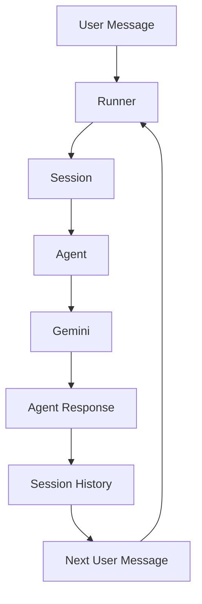
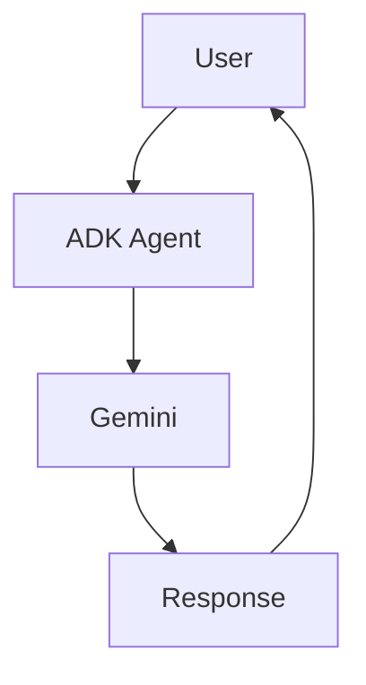
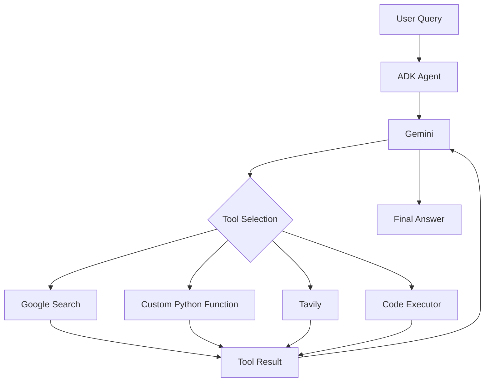
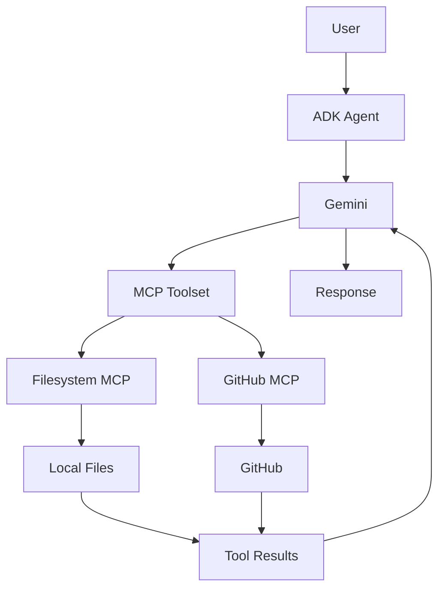
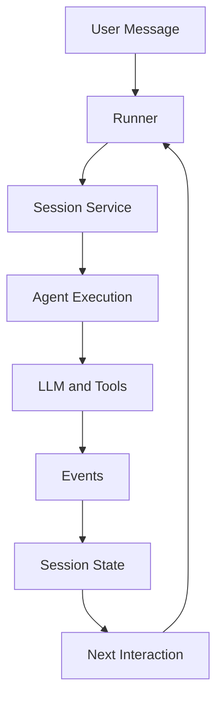

<div align="center">

# 🤖 Google ADK — Agentic AI Playground

### Building, Exploring & Learning AI Agents with Google Agent Development Kit

<p>
  
  
  
  
  
  
</p>

**A hands-on repository exploring AI agents, tool calling, multi-tool orchestration, MCP integrations, structured outputs, session management, and intelligent automation.**

[Explore Projects](#-projects) · [Installation](#-installation) · [Run Agents](#-running-the-agents) · [Technologies](#-technology-stack)

</div>

---

# 📖 About This Repository

This repository is my practical learning journey with **Google Agent Development Kit (ADK)**.

Rather than focusing only on simple LLM conversations, I am exploring how to build AI agents that can interact with tools, perform tasks, access external services, execute code, manage workflows, and maintain conversational context.

The projects progress from basic AI agents to more advanced agentic workflows involving external tools and the Model Context Protocol (MCP).

### 🎯 What I'm Exploring

- Building AI agents with Google ADK
- Gemini model integration
- Agent instructions and configuration
- Tool calling and function calling
- Google Search integration
- Custom Python tools
- Third-party tools using LangChain
- Python code execution
- Multi-tool agent orchestration
- Model Context Protocol (MCP)
- Local and remote MCP servers
- Filesystem and GitHub integrations
- AI coding agents
- Human approval workflows
- Structured outputs using Pydantic
- Session management and conversation history
- Runner-based agent execution
- Stateful conversational applications

---

# 🗺️ Repository Roadmap

This repository is organized into individual projects, with each folder focusing on a different concept or capability of Google ADK.

| # | Project | Concepts |
|---|---|---|
| 01 | `mayank_negi` | Basic Gemini Agent |
| 02 | `search_file` | Google Search Tool |
| 03 | `tavily_search_agent` | Tavily + LangChain Integration |
| 04 | `world_clock_agent` | Custom Python Function Tool |
| 05 | `code_execution_agent` | Python Code Execution |
| 06 | `combined_tool_agent` | Multi-Tool Agent |
| 07 | `mcp_agent` | Filesystem + GitHub MCP |
| 08 | `coding_agent` | AI Coding Agent + MCP + Approvals |
| 09 | `structured_output` | Pydantic + Structured Output |
| 10 | `runner_chatbot_demo` | Runner-Based Chatbot Learning |
| 11 | `session_runner_demo` | Sessions + Runner Learning |

---

# 🚀 Projects

## 01 — Basic Gemini Agent

📁 `mayank_negi/`

My first basic conversational AI agent built using Google ADK and Gemini.

### What it does

- Accepts natural-language questions.
- Generates responses using a Gemini model.
- Follows system instructions.
- Demonstrates the basic structure of an ADK agent.

### Concepts

- `Agent`
- Model configuration
- Agent instructions
- Agent name and description
- Basic LLM interaction

---

## 02 — Google Search Agent

📁 `search_file/`

An AI agent that uses Google's built-in Search capability to retrieve information from the web.

### What it does

- Accepts user queries.
- Uses Google Search when external information is required.
- Generates responses grounded in retrieved information.

### Concepts

- Built-in ADK tools
- Google Search
- Tool calling
- Search-grounded responses

> The folder name is `search_file`, but the implementation uses Google Search rather than local file searching.

---

## 03 — Tavily Search Agent

📁 `tavily_search_agent/`

An agent integrating Tavily Search with Google ADK through LangChain.

### What it does

- Performs web searches using Tavily.
- Retrieves relevant search results.
- Uses external information to answer user queries.

### Technologies

- Google ADK
- Gemini
- LangChain
- LangChain Tavily
- Tavily API

### Concepts

- Third-party tool integration
- `LangchainTool`
- Tool interoperability
- External search APIs

---

## 04 — World Clock Agent

📁 `world_clock_agent/`

An AI agent using a custom Python function to retrieve timezone-aware date and time information.

### What it does

- Retrieves the current time for different locations.
- Uses timezone identifiers.
- Returns date, time, timezone and weekday.
- Handles invalid timezone inputs.

### Example Timezones

```text
Asia/Kolkata
America/New_York
Europe/London
Asia/Tokyo
```

### Technologies

- Python
- `datetime`
- `zoneinfo`

### Concepts

- Custom function tools
- Tool arguments
- Function return values
- Timezone-aware programming
- Exception handling
- Deterministic tool execution

---

## 05 — Code Execution Agent

📁 `code_execution_agent/`

An AI agent using the ADK `BuiltInCodeExecutor` to perform tasks that require Python execution.

### What it does

- Understands a programming or calculation request.
- Generates Python code when required.
- Executes code using the configured code executor.
- Uses execution results to generate a response.

### Technologies

- Google ADK
- Gemini
- Python
- `BuiltInCodeExecutor`

### Concepts

- Code generation
- Code execution
- Tool-assisted reasoning
- Programmatic calculations
- Execution results

> ⚠️ Generated code should be executed only in an appropriately controlled environment.

---

## 06 — Combined Multi-Tool Agent

📁 `combined_tool_agent/`

An agent combining multiple capabilities in a single system.

### Integrated Tools

| Tool | Capability |
|---|---|
| Google Search | Search the web |
| Tavily Search | External web research |
| Custom Time Function | Retrieve timezone information |
| BuiltInCodeExecutor | Execute Python code |

### What it does

The agent receives a user's request and can select from the available tools to accomplish the task.

### Concepts

- Multi-tool integration
- Tool selection
- Tool orchestration
- Custom Python tools
- Built-in tools
- External integrations
- Combining LLMs with deterministic functions

---

## 07 — GitHub Publisher MCP Agent

📁 `mcp_agent/`

An agent exploring the **Model Context Protocol (MCP)** to connect Google ADK with external tool servers.

### Integrated MCP Servers

#### 📂 Filesystem MCP

Uses:

```text
@modelcontextprotocol/server-filesystem
```

Provides access to filesystem tools within the configured workspace.

The server is launched locally using Node.js / npx and communicates through stdio.

#### 🐙 GitHub MCP

Connects to:

```text
https://api.githubcopilot.com/mcp/
```

Uses a GitHub token for authentication.

### Architecture

```text
                Google ADK Agent
                       |
                     Gemini
                       |
                   McpToolset
                  /          \
                 /            \
       Filesystem MCP       GitHub MCP
            |                   |
      Local Workspace       GitHub API
```

### Concepts

- Model Context Protocol
- MCP servers
- MCP client integrations
- Stdio transport
- Streamable HTTP transport
- Filesystem tools
- GitHub tools
- Authentication
- External tool discovery

---

## 08 — AI Coding Agent

📁 `coding_agent/`

An AI coding assistant designed to explore how agents can interact with a development environment.

### Integrated Capabilities

| Integration | Capability |
|---|---|
| Filesystem MCP | Read and manage project files |
| Shell MCP Server | Execute development commands |
| GitHub MCP | GitHub operations when configured |

### What it explores

- Inspecting codebases
- Creating and modifying files
- Executing commands
- Running tests
- Managing development servers
- Reading logs
- Checking application endpoints
- Interacting with GitHub

### Approval Workflow

The implementation includes approval checks for selected operations.

Some commands can run automatically, while potentially sensitive operations require confirmation.

### Concepts

- Coding agents
- MCP integration
- Shell tools
- Filesystem access
- Tool filtering
- Human-in-the-loop approval
- Test execution
- Development workflows
- GitHub integration

> ⚠️ Approval mechanisms are safeguards, not a complete security boundary. Always review permissions, commands and workspace access.

---

## 09 — Structured Output Agent

📁 `structured_output/`

An agent that extracts information from natural-language messages and returns it in a predefined structured format.

The implementation explores Pydantic schemas and Google ADK's structured output capabilities.

### Example Use Case

Extract student enquiry information:

- Name
- Email
- Course interests
- Budget

### Example Input

```text
Hi, my name is Rahul Sharma.

My email is rahul@example.com.

I am interested in GenAI and MLOps.

My budget is 15,000 INR.
```

### Expected Output

```json
{
  "name": "Rahul Sharma",
  "email": "rahul@example.com",
  "interested_in": [
    "GenAI",
    "MLOps"
  ],
  "budget_inr": 15000
}
```

### Technologies

- Pydantic
- Python type hints
- Google ADK
- Structured output

### Concepts

- `BaseModel`
- `Field`
- `Literal`
- Schema validation
- `output_schema`
- `output_key`
- Structured information extraction

---

## 10 — Runner Chatbot Demo

📁 `runner_chatbot_demo/`

A dedicated learning project exploring how an ADK agent can be executed through a Runner-based application.

### Learning Focus

- Agent execution
- Runner initialization
- Sending user messages to an agent
- Receiving agent events
- Processing agent responses
- Understanding the execution lifecycle

This project is intended to help understand how an agent can be run programmatically outside the ADK web interface.

---

## 11 — Session Runner Demo

📁 `session_runner_demo/`

A learning project focused on understanding the relationship between ADK sessions, runners and conversational state.

### Learning Focus

- Creating and managing sessions
- Understanding session IDs
- User IDs
- Conversation history
- Stateful conversations
- Runner execution
- Message handling
- Agent events
- Maintaining context between user messages

### Conceptual Workflow



The purpose of this project is to understand how an agent can retain conversational context across multiple interactions when the appropriate session and state mechanisms are configured.

---

# 🏗️ Agent Architecture

## Basic Agent



## Tool-Enabled Agent



## MCP-Enabled Agent



## Stateful Agent



---

# 🧰 Technology Stack

| Technology | Purpose |
|---|---|
| Python | Primary programming language |
| Google ADK | Agent development and orchestration |
| Gemini | Large Language Model |
| Google Search | Search and retrieval |
| Tavily | Web search |
| LangChain | Tool integrations |
| Pydantic | Structured data and validation |
| MCP | External tool connectivity |
| McpToolset | MCP integration with ADK |
| Node.js | Local MCP server execution |
| Filesystem MCP | Local workspace access |
| GitHub MCP | GitHub tool integration |
| Python datetime | Time handling |
| Python zoneinfo | Timezone handling |
| Git | Version control |
| GitHub | Code hosting |

---

# ⚙️ Installation

## Prerequisites

Install the following:

- Python
- Git
- Node.js and npm
- Google AI Studio API key

Some agents additionally require:

- Tavily API key
- GitHub Personal Access Token

Verify your installation:

```bash
python --version
git --version
node --version
npm --version
```

---

## 1. Clone the Repository

```bash
git clone https://github.com/mayanknegi22/Google-adk.git
```

## 2. Navigate to the Project

```bash
cd Google-adk
```

## 3. Create a Virtual Environment

```bash
python -m venv .venv
```

## 4. Activate the Environment

### Windows PowerShell

```powershell
.\.venv\Scripts\Activate.ps1
```

If PowerShell blocks activation:

```powershell
Set-ExecutionPolicy -Scope Process -ExecutionPolicy Bypass
.\.venv\Scripts\Activate.ps1
```

### Linux / macOS

```bash
source .venv/bin/activate
```

## 5. Install Google ADK

```bash
pip install google-adk
```

For MCP projects:

```bash
pip install "google-adk[mcp]"
```

For Tavily integration:

```bash
pip install -U langchain-tavily
```

For environment variable management:

```bash
pip install python-dotenv
```

Install additional dependencies if required by a specific project.

---

# 🔑 Environment Configuration

Create the appropriate `.env` file for the agent you want to run.

### Google Gemini

```env
GOOGLE_GENAI_USE_VERTEXAI=FALSE
GOOGLE_API_KEY=your_google_api_key
```

### Tavily

```env
TAVILY_API_KEY=your_tavily_api_key
```

### GitHub MCP

```env
GITHUB_TOKEN=your_github_token
```

### Coding Agent

```env
WORKSPACE_DIR=workspace
GITHUB_PAT=your_github_personal_access_token
```

The environment variable names depend on the individual project's implementation.

### API Key Resources

| Service | Link |
|---|---|
| Google AI Studio | https://aistudio.google.com/apikey |
| Tavily | https://tavily.com/ |
| GitHub Tokens | https://github.com/settings/tokens |

> 🔐 Never commit API keys, tokens, `.env` files, or credentials to GitHub.

---

# ▶️ Running the Agents

Run commands from the repository root.

## Start the ADK Web Interface

```bash
adk web
```

This launches the ADK developer interface for locally available agents.

## Run an Individual Agent

```bash
adk run mayank_negi
```

### Available Agents

```bash
adk run mayank_negi
adk run search_file
adk run tavily_search_agent
adk run world_clock_agent
adk run code_execution_agent
adk run combined_tool_agent
adk run mcp_agent
adk run coding_agent
adk run structured_output
```

The `runner_chatbot_demo` and `session_runner_demo` folders are learning projects for programmatic execution and session handling. Follow their individual Python entry points as they are developed.

---

# 🧠 Concepts I'm Learning

| Concept | Description |
|---|---|
| Agents | LLM-powered systems following instructions |
| Tools | Functions and external capabilities available to agents |
| Tool Calling | Agents deciding when and how to invoke tools |
| Agent Orchestration | Coordinating multiple tools and agents |
| MCP | Standard protocol for connecting tools and services |
| Sessions | Managing conversation history and state |
| Runners | Executing agents and managing interaction flows |
| Events | Representing agent execution and responses |
| Structured Output | Producing validated data from LLMs |
| Human-in-the-Loop | Requiring human confirmation for sensitive actions |

---

# 🔭 Future Roadmap

This repository is continuously evolving.

### Planned Explorations

- [ ] Advanced multi-agent systems
- [ ] Agent delegation
- [ ] Sequential and parallel workflows
- [ ] Session persistence
- [ ] Memory and context management
- [ ] More MCP integrations
- [ ] RAG-powered agents
- [ ] Agent evaluation
- [ ] Observability and tracing
- [ ] API integrations
- [ ] Deployment with Docker
- [ ] Deployment to Google Cloud
- [ ] Production-oriented agent architectures

---

# 📚 Learning Resources

| Resource | Link |
|---|---|
| Google ADK Documentation | https://google.github.io/adk-docs/ |
| Google ADK Python Repository | https://github.com/google/adk-python |
| Model Context Protocol | https://modelcontextprotocol.io/ |
| MCP Servers | https://github.com/modelcontextprotocol/servers |
| Google AI Studio | https://aistudio.google.com/ |
| LangChain | https://python.langchain.com/ |
| Tavily Documentation | https://docs.tavily.com/ |
| Pydantic | https://docs.pydantic.dev/ |

---

# 🔒 Security Considerations

Some projects in this repository interact with local files, execute code, run commands, or access external services.

- Never expose API keys or tokens.
- Keep `.env` files out of version control.
- Restrict filesystem access to designated workspaces.
- Use least-privilege GitHub tokens.
- Review potentially destructive shell commands.
- Use approval mechanisms for sensitive operations.
- Do not run untrusted generated code in environments containing sensitive data.

---

# 👨‍💻 About Me

## Mayank Negi

**MCA Graduate | Aspiring AI Engineer | Generative AI & Agentic AI Enthusiast**

I am focused on building practical AI applications and developing my skills in Python, Generative AI, LLM applications, RAG, Agentic AI, and backend development.

I believe in learning by building, experimenting, understanding the underlying concepts, and continuously improving through hands-on projects.

### Connect With Me

- GitHub: [@mayanknegi22](https://github.com/mayanknegi22)
- Google ADK Projects: [Google-adk](https://github.com/mayanknegi22/Google-adk)

---

<div align="center">

### 🚀 Build. Experiment. Learn. Improve.

**Exploring the future of Agentic AI, one project at a time.**

</div>
