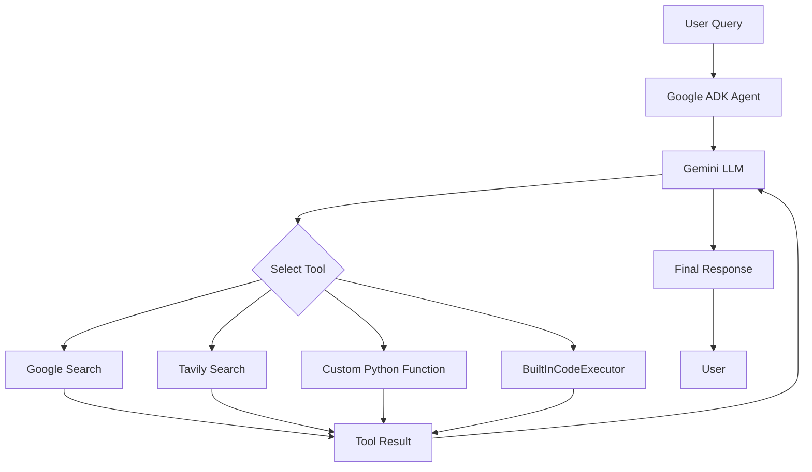
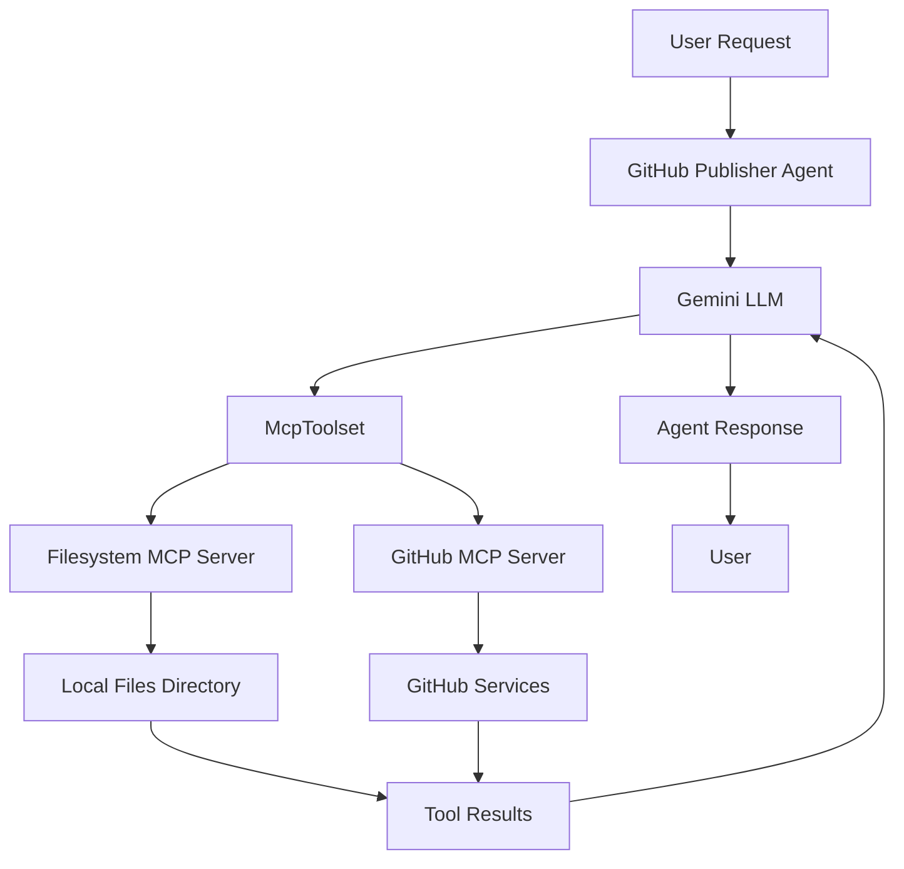

# Google ADK – AI Agents & MCP Projects

### Exploring Agentic AI, Tool Integration, MCP and LLM-powered Applications with Python

<p align="left">
  
  
  
  
  
</p>

---

## About This Repository

Welcome to my **Google ADK – AI Agents & MCP Projects** repository.

This repository contains my hands-on implementations and experiments with Google's **Agent Development Kit (ADK)**.

My objective is to understand how modern AI agents work beyond basic LLM interactions by building agents that can use external tools, retrieve information, execute Python code, interact with local files, and connect with external services through the Model Context Protocol (MCP).

The repository demonstrates a progression from basic conversational agents to tool-enabled agents and MCP-powered integrations.

### What I'm Exploring

- Building LLM-powered agents using Google ADK.
- Integrating Google Search and Tavily Search.
- Creating custom Python function tools.
- Executing Python code through AI agents.
- Integrating multiple tools into a single agent.
- Connecting local and remote MCP servers.
- Using MCP to expose external capabilities to AI agents.
- Exploring agent orchestration and tool selection.

---

# Projects

## 1. Basic Gemini Agent

**Directory:** `mayank_negi/`

A basic conversational AI agent built using Google's Agent Development Kit and Gemini.

This implementation demonstrates the fundamental structure of an ADK agent without additional external tools.

**Features:**
- Accepts user questions and instructions.
- Uses Gemini to generate responses.
- Follows the instructions defined in the agent configuration.

**Concepts explored:**
- ADK agent initialization.
- Gemini model configuration.
- Agent name and description.
- Instruction-based agent behavior.
- Basic LLM interaction.

**Model:** `gemini-3.5-flash`

---

## 2. Google Search Agent

**Directory:** `search_file/`

An AI agent integrated with Google's built-in Search tool.

The agent can retrieve current information through Google Search instead of relying exclusively on the model's existing knowledge.

**Features:**
- Accepts user queries.
- Uses Google Search when current information is required.
- Retrieves information to help answer questions.
- Supports fact verification through web search.

**Concepts explored:**
- Built-in ADK tools.
- Google Search integration.
- LLM tool selection.
- Search-grounded responses.

**Model:** `gemini-3.5-flash`

**Note:** The current implementation uses Google Search. It does not implement local file searching.

---

## 3. Tavily Search Agent

**Directory:** `tavily_search_agent/`

An AI agent that integrates Tavily Search through LangChain and Google's ADK.

The implementation uses ADK's `LangchainTool` wrapper to make a third-party LangChain tool available to the agent.

**Features:**
- Performs web searches using Tavily.
- Configures general search with up to five results.
- Uses retrieved search results to help answer user queries.

**Technologies:**
- Google ADK
- Gemini
- LangChain
- `langchain-tavily`
- Tavily Search

**Concepts explored:**
- Third-party tool integration.
- LangChain and ADK interoperability.
- `LangchainTool`.
- External search capabilities.

**Model:** `gemini-3.5-flash`

---

## 4. World Clock Agent

**Directory:** `world_clock_agent/`

A specialized AI agent that retrieves the current date and time for different locations around the world.

It uses a custom Python function with the `datetime` and `zoneinfo` modules.

**Features:**
- Accepts location-related time queries.
- Uses IANA timezone identifiers.
- Retrieves the current local date and time.
- Returns timezone, date, time, and weekday.
- Handles invalid timezone names.

**Example timezones:**

- `Asia/Kolkata`
- `America/New_York`
- `Europe/London`

**Technologies:**
- Python
- `datetime`
- `zoneinfo`
- Google ADK
- Gemini

**Concepts explored:**
- Custom Python function tools.
- Function arguments and return values.
- Timezone-aware date and time handling.
- Exception handling.
- Connecting deterministic Python functionality with an LLM.

---

## 5. Code Execution Agent

**Directory:** `code_execution_agent/`

An AI agent configured with Google's built-in `BuiltInCodeExecutor`.

This agent is designed to write and execute Python code when a task involves calculations, data analysis, or other operations that benefit from programmatic execution.

**Features:**
- Understands the user's request.
- Generates Python code when execution is useful.
- Executes code using ADK's built-in code executor.
- Explains the execution result.

**Technologies:**
- Google ADK
- Gemini
- Python
- `BuiltInCodeExecutor`

**Concepts explored:**
- LLM-generated Python code.
- Built-in ADK code executors.
- Programmatic calculations.
- Combining LLM reasoning with code execution.

**Security consideration:** Generated code should only run in an appropriately controlled environment. Avoid exposing sensitive files, credentials, or systems to untrusted generated code.

---

## 6. Combined Multi-Tool Agent

**Directory:** `combined_tool_agent/`

This is one of the most comprehensive implementations in the repository.

It combines multiple tools within a single Gemini-powered ADK agent, allowing the model to select the appropriate capability according to the user's request.

### Integrated Tools

| Tool | Purpose |
|---|---|
| Google Search | Retrieves current information and verifies facts. |
| Tavily Search | Provides additional web research and search results. |
| Custom Time Function | Retrieves current date and time for a requested timezone. |
| BuiltInCodeExecutor | Executes Python code for calculations and data analysis. |

**Features:**
- Searches the web using Google Search.
- Uses Tavily for additional search results.
- Retrieves current time across different timezones.
- Executes Python code for calculations and data analysis.
- Uses agent instructions to guide tool selection.
- Supports multiple capabilities through one agent.

**Concepts explored:**
- Multiple tool integration.
- Custom function tools.
- Built-in ADK tools.
- Third-party tool integration.
- Tool selection and orchestration.
- Combining LLM reasoning with deterministic Python functions.

**Model:** `gemini-3.5-flash`

---

## 7. GitHub Publisher – MCP Agent

**Directory:** `mcp_agent/`

This project explores the **Model Context Protocol (MCP)** and how external MCP servers can be connected to a Google ADK agent.

The agent is configured with two MCP server integrations:

1. Filesystem MCP Server
2. GitHub MCP Server

The implementation uses Google's `McpToolset` to connect MCP servers and expose their available tools to the ADK agent.

### MCP Server Integrations

#### A. Filesystem MCP Server

The local filesystem server is launched using:

`@modelcontextprotocol/server-filesystem`

It runs through Node.js and `npx` using a standard input/output (stdio) connection.

**What it provides:**
- Access to files and directories within the configured folder.
- Filesystem operations through MCP-exposed tools.
- A controlled working directory for file operations.

The agent creates a `files` directory inside its own project folder and passes its absolute path to the filesystem MCP server.

This limits the server's configured filesystem access to that directory.

#### B. GitHub MCP Server

The GitHub integration connects to the GitHub Copilot MCP endpoint using Streamable HTTP.

**Endpoint:**

`https://api.githubcopilot.com/mcp/`

**Authentication:**
- Uses a GitHub token.
- Reads `GITHUB_TOKEN` from environment variables.
- Sends the token through the HTTP Authorization header.

This allows the agent to access the tools exposed by the connected GitHub MCP server, subject to the token's permissions and the server's capabilities.

### How MCP Is Integrated with ADK

The implementation uses:

- `McpToolset`
- `StdioConnectionParams`
- `StreamableHTTPConnectionParams`
- `StdioServerParameters`

The two MCP servers use different connection mechanisms:

| MCP Server | Connection | Purpose |
|---|---|---|
| Filesystem | Local stdio | Local file and directory operations |
| GitHub | Remote Streamable HTTP | GitHub-related operations |

**Agent name:** `github_publisher`

**Model:** `gemini-3.5-flash`

### Concepts Explored

- Model Context Protocol (MCP).
- MCP client-server architecture.
- Connecting local MCP servers.
- Connecting remote MCP servers.
- Standard input/output transport.
- Streamable HTTP transport.
- MCP tool discovery and integration.
- Environment-based authentication.
- Integrating external tools with Google ADK.

---

# Project Comparison

| Agent | Main Capability | Integration |
|---|---|---|
| `mayank_negi` | Conversational AI | Gemini |
| `search_file` | Web search | Google Search |
| `tavily_search_agent` | Web research | Tavily |
| `world_clock_agent` | Timezone information | Custom Python function |
| `code_execution_agent` | Python execution | BuiltInCodeExecutor |
| `combined_tool_agent` | Multiple capabilities | Google Search, Tavily, Python tools |
| `mcp_agent` | External tool integration | Filesystem MCP and GitHub MCP |

---

# Repository Structure

```text
Google-adk/
│
├── code_execution_agent/
│   └── agent.py
│
├── combined_tool_agent/
│   └── agent.py
│
├── mayank_negi/
│   └── agent.py
│
├── mcp_agent/
│   ├── agent.py
│   └── files/
│
├── search_file/
│   └── agent.py
│
├── tavily_search_agent/
│   └── agent.py
│
├── world_clock_agent/
│   └── agent.py
│
├── .gitignore
└── README.md
```

The `files/` directory is created by the MCP agent at runtime if it does not already exist.

---

# Architecture Overview

## 1. Tool-Enabled ADK Agent

The following diagram illustrates the general workflow explored in the tool-enabled agents.



## 2. MCP Agent Architecture

The following diagram represents the MCP integration implemented in `mcp_agent`.



---

# Technology Stack

| Technology | Purpose |
|---|---|
| Python | Primary programming language |
| Google ADK | AI agent development and orchestration |
| Gemini | Large Language Model |
| Google Search | Web information retrieval |
| Tavily | Third-party web search |
| LangChain | Third-party tool integration |
| BuiltInCodeExecutor | Python code execution |
| MCP | Standardized tool and context integration |
| McpToolset | Connects MCP servers to ADK agents |
| Node.js / npx | Runs the local filesystem MCP server |
| Filesystem MCP | Local file operations |
| GitHub MCP | GitHub-related tool integration |
| python-dotenv | Environment variable management |
| Git & GitHub | Version control |

---

# Getting Started

## Prerequisites

Before running the projects, install:

- Python version supported by your Google ADK release.
- Git.
- Node.js and npm (required for the filesystem MCP server).
- Google AI Studio API key.
- Tavily API key for Tavily-based agents.
- GitHub token for the GitHub MCP integration.

Verify that Python, ADK, and npx are available:

```powershell
python --version
adk --help
node --version
npm --version
npx --version
```

## 1. Clone the Repository

```bash
git clone https://github.com/mayanknegi22/Google-adk.git
```

## 2. Navigate to the Project

```bash
cd Google-adk
```

## 3. Create a Virtual Environment

```bash
python -m venv .venv
```

## 4. Activate the Environment

**Windows PowerShell**

```powershell
.\.venv\Scripts\Activate.ps1
```

**Linux / macOS**

```bash
source .venv/bin/activate
```

## 5. Install Dependencies

Install Google ADK with MCP support:

```bash
pip install "google-adk[mcp]"
```

Install the additional integrations:

```bash
pip install -U langchain-tavily python-dotenv
```

## 6. Configure Environment Variables

Create a `.env` file in the repository root or an appropriate agent directory.

```env
GOOGLE_GENAI_USE_VERTEXAI=FALSE

GOOGLE_API_KEY=your_google_api_key

TAVILY_API_KEY=your_tavily_api_key

GITHUB_TOKEN=your_github_token
```

### API Key Resources

- Gemini API Key: https://aistudio.google.com/apikey
- Tavily API Key: https://tavily.com/
- GitHub: https://github.com/settings/tokens

**Important Security Notes:**

- Never upload your `.env` file to GitHub.
- Never hardcode API keys or tokens inside Python files.
- Give tokens only the permissions required for your tasks.
- Keep the filesystem MCP server restricted to the intended working directory.
- Review file and GitHub operations before allowing an agent to execute them.

## 7. Run the Agents

From the repository root:

```bash
adk web
```

You can select the agent you want to test in the ADK web interface.

Alternatively, run an individual agent:

```bash
adk run mayank_negi
```

Other agents:

```bash
adk run search_file
adk run tavily_search_agent
adk run world_clock_agent
adk run code_execution_agent
adk run combined_tool_agent
adk run mcp_agent
```

Make sure the required API keys and dependencies are configured for the selected agent.

For the MCP agent, Node.js/npx must be available, and the GitHub token must be valid for the configured GitHub MCP service.

---

# Key Learning Areas

Through these projects, I am exploring:

- Fundamentals of Agentic AI.
- Google ADK architecture.
- Gemini model integration.
- Agent instructions and configurations.
- Built-in ADK tools.
- Custom Python function tools.
- Third-party tool integration.
- Web search and information retrieval.
- Python code execution.
- Multiple tool orchestration.
- Model Context Protocol.
- Local and remote MCP servers.
- MCP transports: stdio and Streamable HTTP.
- External service authentication.

---

# Future Improvements

- [ ] Implement actual local file-search functionality.
- [ ] Explore more MCP servers and integrations.
- [ ] Add MCP tool filtering and access controls.
- [ ] Explore multi-agent systems and agent delegation.
- [ ] Implement session management and memory.
- [ ] Add structured logging and error handling.
- [ ] Explore agent evaluation and testing.
- [ ] Build advanced RAG and Agentic AI applications.
- [ ] Explore deployment of ADK agents.

---

# Learning Resources

| Resource | Link |
|---|---|
| Google ADK Documentation | https://google.github.io/adk-docs/ |
| Google ADK Python | https://github.com/google/adk-python |
| MCP Official Documentation | https://modelcontextprotocol.io/ |
| MCP Servers | https://github.com/modelcontextprotocol/servers |
| Google AI Studio | https://aistudio.google.com/ |
| LangChain Documentation | https://python.langchain.com/docs/ |
| Tavily Documentation | https://docs.tavily.com/ |

---

# About Me

**Mayank Negi**

MCA Graduate | Aspiring AI Engineer | Generative AI & Agentic AI Enthusiast

I am passionate about building practical AI applications and continuously improving my understanding of Python, Large Language Models, RAG systems, Agentic AI, and MCP-based integrations.

**GitHub:** https://github.com/mayanknegi22

**Repository:** https://github.com/mayanknegi22/Google-adk

---

<p align="center">
  <strong>Building. Learning. Experimenting with Agentic AI.</strong>
</p>
